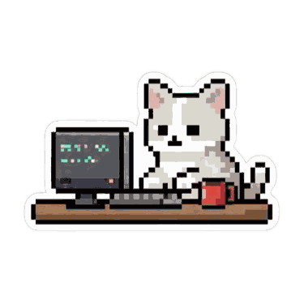

# Hi, I'm Inés 👋

**UX/UI Designer & Front-End Developer** based in Spain 🇪🇸
I design interfaces people enjoy using and build them with clean, accessible front-end code.

### What I do
- 🎨 UX/UI design: user research, wireframes, prototypes and design systems
- 💻 Front-end development: turning designs into responsive, accessible interfaces
- 🤝 Organizer at **GDG Alicante**

### Tech stack

 

### Featured project
📸 **[cutebooth](https://github.com/lylyam/cuteBooth)** – a web photobooth: pick a layout, take or upload photos, decorate your strip and download it.

### Let's connect

