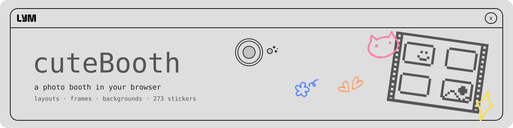

# Hi, I'm Inés 👋

**Full-Stack Developer**
I build web apps end to end, from the database and the API to the interface people actually use. I worked as a UX/UI designer before, and it still shows in how I build.

### What I do
- 💻 Full-stack development: responsive, accessible front ends, REST APIs and relational databases
- 🎨 A UX/UI background, so the product thinking comes built in
- 🤝 Organizer at **GDG Alicante** and **MultitecUA**

### Tech stack

 

### Featured projects

🧵 **[Nudo](https://github.com/PI-InesFuentes)** – my Intermodular Project (DAW, in progress): a SaaS for small craft workshops where booking a seat also reserves the material it uses. React · Laravel · PostgreSQL.

📸 **[cutebooth](https://github.com/lylyam/cuteBooth)** – a web photobooth: pick a layout, take or upload photos, decorate your strip and download it.

### Communities I organize
&nbsp;

### Let's connect

